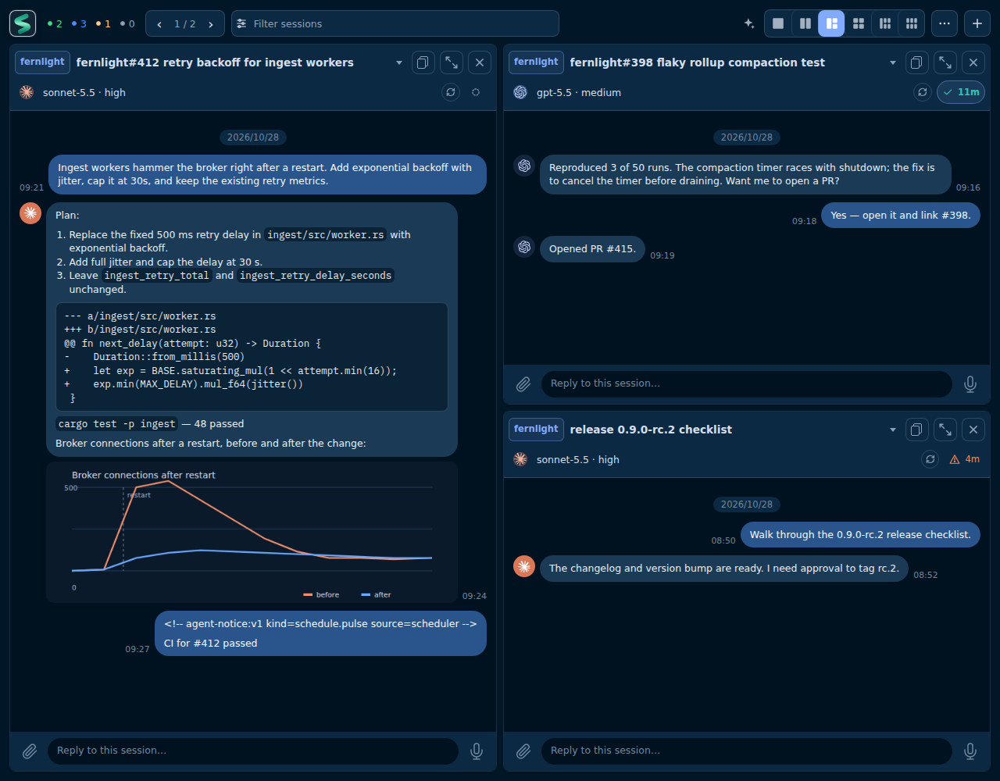
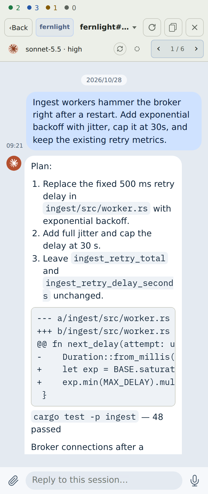

# Salon

Salon is a self-hostable, container-first chat workspace for working with
coding agents from a browser. Start a session, talk to it, and reconnect to the
same session later.

Salon is being bootstrapped. The shared, edge and UI core libraries can be built
and packed locally, but the first usable application milestone is still pending.
Library checks do not establish container startup or provider acceptance.

## Preview

<p>
  
  
</p>

*UI preview with synthetic data: desktop in the Dark theme, phone in the Paper theme*

The previews show the UI core rendered with fictional sessions served by a
stand-in daemon. They are not a provider session. See
[DEVELOPMENT.md](DEVELOPMENT.md#ui-previews) to regenerate them.

## What works today and what is planned

The reusable core libraries produce JavaScript, declarations and required assets.
An isolated package consumer exercises those artifacts without workspace source
links. See [package consumption](docs/package-consumption.md) for that developer path.

The first developer milestone will support one provider. The full MVP will
support two providers. The intended user flow for those milestones runs from a
published image, with no source build:

1. Pull and start the workspace from the pinned image, then run the smoke check.
2. Complete official provider login or API-key setup.
3. Create a session and send a prompt.
4. Receive an actual provider reply.
5. Refresh the browser or reconnect to the same session.

Only step 1 can be checked without a provider account. Steps 2 to 5 are
accepted only after the scheduled tester run on a clean Linux host; do not read
this section as a claim that they have passed. The local core package checks do
not establish them either.

### Start from the published image

Each SDK release publishes a linux/amd64 image to
`ghcr.io/sympoies/salon` and appends its immutable reference to the release
notes. The image is published only for release tags created after this
workflow exists. Copy `compose.image.yaml` and `scripts/smoke-compose.sh` from
the matching tag, then set the reference from those notes:

```bash
export SALON_IMAGE=ghcr.io/sympoies/salon@sha256:<digest-from-release-notes>
docker compose -f compose.image.yaml up -d
bash scripts/smoke-compose.sh compose.image.yaml
```

`compose.image.yaml` matches `compose.yaml` (loopback port 3000, volumes,
read-only root, memory limit, init, non-root user and health check) except that
it pulls `SALON_IMAGE` instead of building the checkout. Compose refuses to
start while `SALON_IMAGE` is unset.

The smoke check needs no provider credentials. It prints one `PASS` or `FAIL`
line per check: container running, container healthy, `/healthz` answering,
the published port bound only to `127.0.0.1:3000`, and no root process. It
exits 0 when all pass, 1 when a check fails and 2 for a missing tool or file.

To build from source instead, use `docker compose up --build`.

## Read session previews and restore drafts

The UI core's session overview cards show the latest user or agent message when available.
For older servers, they fall back to the last user prompt. In Settings,
**Card preview** offers **Latest message** (default) and **My last prompt**.
The choice is saved on the current device, including on the mobile layout.

When the session runtime saves a draft, Salon marks the session with its save
time. Open its conversation to read saved drafts and restore one to the reply
composer. Replacing existing text requires confirmation. Restoring does not
send the draft.

## Track outgoing replies and attachments

When a session is replaced or removed, Salon automatically clears its
unconfirmed outgoing replies across clients once the server confirms the
change. Cached replies disappear when the conversation next syncs. This does
not retract messages already delivered.

Outgoing attachments show their sanitized upload names in this browser's outbox.
Newly attached raster images also have a local preview while the reply is pending
or refused. History shows the original name when the session runtime supplies
it; otherwise it uses the neutral image label. Delivered non-image cards also use
the original name when the runtime supplies managed file parts. Without that
metadata, they keep the neutral file-kind label.

Refused external images show “External image, not loaded” and their source origin
when provided. An **Open link** action appears when the full link is known from the
message text. Salon loads no external image; opening the link uses your browser.

Other files appear as cards with an original name or neutral kind, their size
when known, and a copy icon. Long names stay on one line while keeping the
extension visible. Select a file card to copy its file path.

## Contribute to Salon

See [DEVELOPMENT.md](DEVELOPMENT.md) for prerequisites and validation, and
[AGENTS.md](AGENTS.md) for contributor instructions. Durable implementation
context is recorded in the [development log](docs/devlog/README.md).

## License

[MIT](LICENSE), copyright Salon contributors.
Bundled fonts retain their separate
[SIL Open Font License and notices](packages/ui/src/fonts/LICENSE.md).
