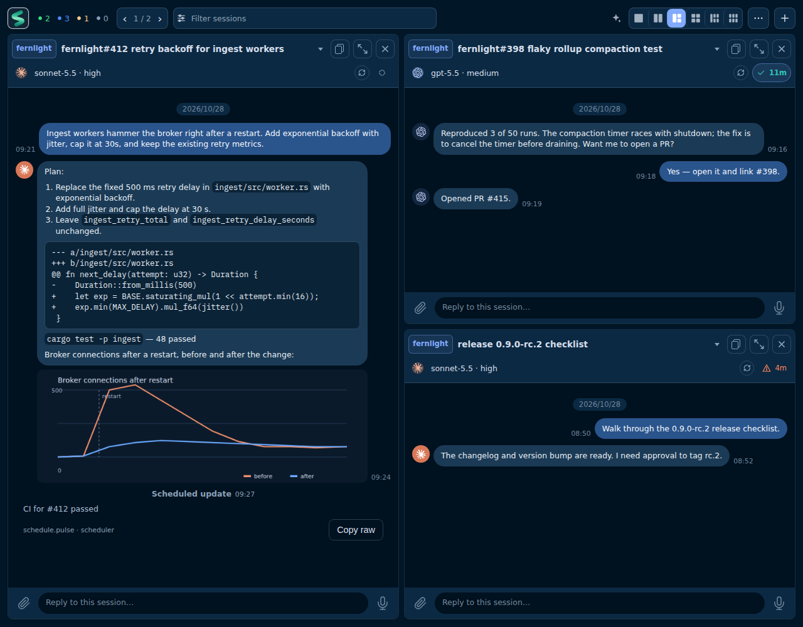
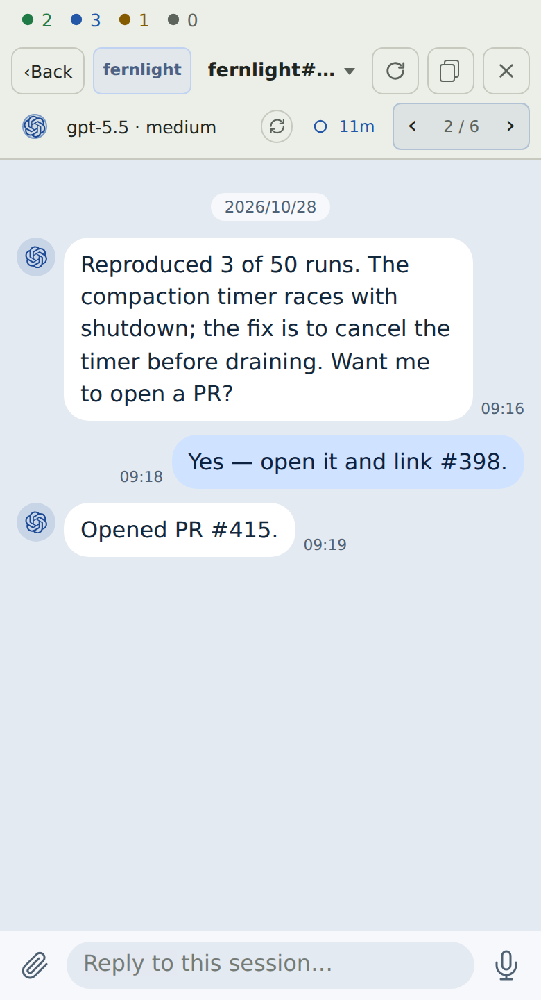

# Salon

Salon is a self-hostable, container-first chat workspace for working with
coding agents from a browser: start a session, talk to it, and reconnect to the
same session later.

## Preview

  
  

*UI preview · synthetic data — desktop in the Dark theme, phone in the Paper theme*

The previews show the UI core rendered with fictional sessions served by a
stand-in daemon. They are not a provider session. See
[DEVELOPMENT.md](DEVELOPMENT.md#ui-previews) to regenerate them.

## Status

Salon is being bootstrapped. The reusable shared, edge and UI core can be built
and packed locally as JavaScript, declarations and required assets. An isolated
package consumer exercises those artifacts without workspace source links.
See [package consumption](docs/package-consumption.md) for that developer path.
The first usable Salon application milestone is still pending; these library
checks do not establish container startup or provider acceptance.

The first developer milestone will support one provider. The full MVP will
support two providers. The intended user flow for those milestones is:

1. Start the workspace with `docker compose up --build`.
2. Complete official provider login or API-key setup.
3. Create a session and send a prompt.
4. Receive an actual provider reply.
5. Refresh the browser or reconnect to the same session.

These are planned application acceptance steps. They are not established by the
local core package checks.

The UI core's session overview cards show the latest user or agent message when
available, falling back to the last user prompt for older servers. In Settings,
**Card preview** offers **Latest message** (default) and **My last prompt**.
The choice is saved on the current device, including on the mobile layout.

## Contributing

See [DEVELOPMENT.md](DEVELOPMENT.md) for prerequisites and validation, and
[AGENTS.md](AGENTS.md) for contributor instructions. Durable implementation
context is recorded in the [development log](docs/devlog/README.md).

## License

[MIT](LICENSE), copyright Salon contributors.
Bundled fonts retain their separate
[SIL Open Font License and notices](packages/ui/src/fonts/LICENSE.md).
