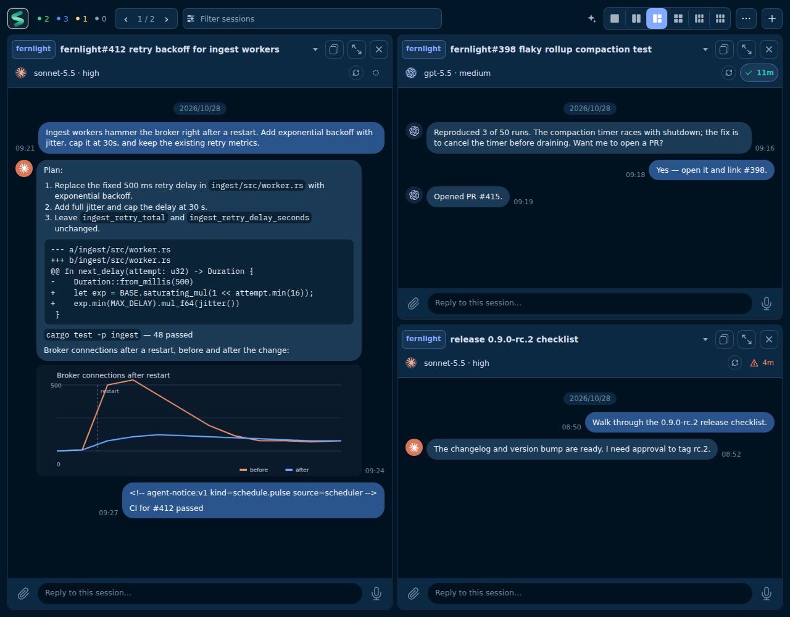
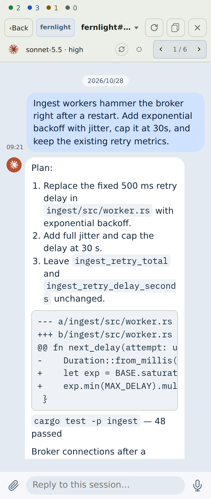

# Salon

Salon is a self-hostable, container-first chat workspace for working with
coding agents from a browser. Start a session, talk to it, and reconnect to the
same session later.

Salon is being bootstrapped. The shared, edge and UI core libraries can be built
and packed locally, but the first usable application milestone is still pending.
Library checks do not establish container startup or provider acceptance.

## Preview

<p>
  
  
</p>

*UI preview with synthetic data: desktop in the Dark theme, phone in the Paper theme*

The previews show the UI core rendered with fictional sessions served by a
stand-in daemon. They are not a provider session. See
[DEVELOPMENT.md](DEVELOPMENT.md#ui-previews) to regenerate them.

## What works today and what is planned

The reusable core libraries produce JavaScript, declarations and required assets.
An isolated package consumer exercises those artifacts without workspace source
links. See [package consumption](docs/package-consumption.md) for that developer path.

The first self-host milestone covers Codex and Claude, each with an API key or
subscription login. The intended user flow runs from a published image:

1. Pull and start the workspace from the pinned image, then run the smoke check.
2. Complete official provider login or API-key setup.
3. Create a session and send a prompt.
4. Receive an actual provider reply.
5. Refresh the browser or reconnect to the same session.

The smoke check and the provider sign-in prompts can be checked without
provider credentials. Signed-in use requires a scheduled tester run on a
clean Linux host.

### Start from the published image

Each SDK release publishes a linux/amd64 image to
`ghcr.io/sympoies/salon`. The publish workflow runs the smoke check against
the pushed digest before adding its immutable reference to the release notes.
The image is published only for release tags created after this
workflow exists. Copy `compose.image.yaml` and `scripts/smoke-compose.sh` from
the matching tag, then set the reference from those notes:

```bash
export SALON_IMAGE=ghcr.io/sympoies/salon@sha256:<digest-from-release-notes>
docker compose -f compose.image.yaml up -d --wait
bash scripts/smoke-compose.sh compose.image.yaml
```

`compose.image.yaml` matches `compose.yaml` (loopback port 3000, volumes,
read-only root, memory limit, init, non-root user and health check) except that
it pulls `SALON_IMAGE` instead of building the checkout. `--wait` returns once the
health check passes, so the smoke check does not race the start period. Compose refuses to
start while `SALON_IMAGE` is unset.

If you started Compose with `-p example`, run
`bash scripts/smoke-compose.sh compose.image.yaml example`. You can also export
`COMPOSE_PROJECT_NAME` before running both commands. The script's project
argument takes precedence over the environment variable.

The smoke check needs no provider credentials. It prints one `PASS` or `FAIL`
line per check: container running, container healthy, `/healthz` answering,
the published port bound only to `127.0.0.1:3000`, and no root process. It
exits 0 when all pass, 1 when a check fails and 2 for a missing tool or file.

Open `http://127.0.0.1:3000` and enter the Salon browser token. Read it in a
private terminal:

```bash
docker compose -f compose.image.yaml exec workspace cat /home/node/.local/state/salon/browser-token
```

Set up the provider you will select in **New**:

| Provider | API key | Subscription |
| --- | --- | --- |
| Codex | [Codex API key](docs/container-development.md#codex-api-key) | [Codex device login](docs/container-development.md#codex-subscription-login) |
| Claude | [Claude API key](docs/container-development.md#claude-api-key) | [Claude browser login](docs/container-development.md#claude-subscription-login) |

To build from source instead, use `docker compose up --build`.

## Sign in another device

In **More → Settings → Devices**, a main-token sign-in can create a one-time QR,
link or manual code for another browser or native app. Compare both screens and confirm the
account before completing sign-in. Each device has a separate 30-day credential;
the device list offers explicit renewal and revocation. See the
[device sign-in guide](docs/device-sign-in-guide.md) for the full flow.
Native shells can import the same HTTPS link into the consent flow. Consumers may
also provide **Scan QR** and browser **Open in app** actions; OS link registration
and camera support belong to the consuming application.

## Read session previews and restore drafts

The UI core's session overview cards show the latest user or agent message when available.
For older servers, they fall back to the last user prompt. In Settings,
**Card preview** offers **Latest message** (default) and **My last prompt**.
The choice is saved on the current device, including on the mobile layout.

When the session runtime saves a draft, Salon marks the session with its save
time. Open its conversation to read saved drafts and restore one to the reply
composer. Replacing existing text requires confirmation. Restoring does not
send the draft.

## Inspect agent tools

Live and saved conversations show compact tool rows when the runtime supplies typed
history parts. Select a tool name to expand its input summary and result. File-edit
results with unified diffs highlight added and removed lines. Summaries are bounded
by the runtime; truncated results are marked. Session owners and root see owner
display text when the runtime supplies it, with credentials still masked. Shared
viewers see the masked summaries.

In Settings → Conversation, **Show tool calls** is on by default. Turn it off
to hide tool calls and results in live and saved conversations immediately.
The choice is saved on this device; text and attachments remain visible.

## Track outgoing replies and attachments

Shared reply bubbles show **Uploading** while the reply is stored on this device
and **Sending** once the workspace accepts it. **Handed to the agent** means the
runtime accepted the reply, including when the provider queued it. If Salon shows
**Refused**, check the reason and use **Retry** after resolving it. **Unknown
outcome** means Salon could not confirm delivery.

When a session is replaced or removed, Salon automatically clears its
unconfirmed outgoing replies across clients once the server confirms the
change. Cached replies disappear when the conversation next syncs. This does
not retract messages already delivered.

Outgoing attachments show their sanitized upload names in this browser's outbox.
Newly attached raster images also have a local preview while the reply is pending
or refused. History shows the original name when the session runtime supplies
it; otherwise it uses the neutral image label. Delivered non-image cards also use
the original name when the runtime supplies managed file parts. Without that
metadata, they keep the neutral file-kind label.

Refused external images show “External image, not loaded” and their source origin
when provided. An **Open link** action appears when the full link is known from the
message text. Salon loads no external image; opening the link uses your browser.

Other files appear as cards with an original name or neutral kind, their size
when known, and a copy icon. Long names stay on one line while keeping the
extension visible. Select a file card to copy its file path.

## Contribute to Salon

See [DEVELOPMENT.md](DEVELOPMENT.md) for prerequisites and validation, and
[AGENTS.md](AGENTS.md) for contributor instructions. Durable implementation
context is recorded in the [development log](docs/devlog/README.md).

## License

[MIT](LICENSE), copyright Salon contributors.
Bundled fonts retain their separate
[SIL Open Font License and notices](packages/ui/src/fonts/LICENSE.md).
