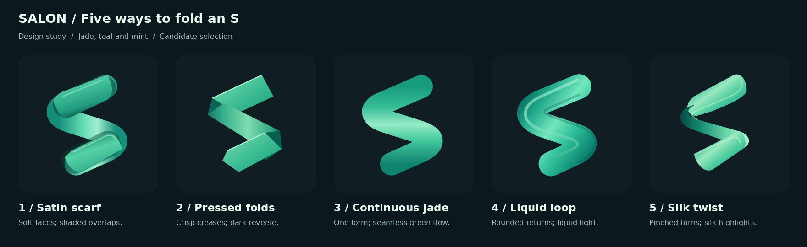

# Salon mark candidates

Five alternatives for maintainer selection. The shipped mark is unchanged.
This first selection round includes one dark 256px preview per candidate;
light variants and 16px/32px checks follow only after a direction is selected.



| Option | Direction | Construction |
| --- | --- | --- |
| 1. Satin scarf | Folded material | Rounded overlapping faces, contact shadows and satin highlights. |
| 2. Pressed folds | Folded material | Angular creases with a dark reverse face and crisp edges. |
| 3. Continuous jade | Gradient | One uninterrupted outline with teal-to-mint transitions and no seams. |
| 4. Liquid loop | Gradient | Broad curved returns, dimensional edge shading and long highlights. |
| 5. Silk twist | Hybrid | Pinched returns connect broad faces through continuous gradient lighting. |

The SVGs are transparent, editable vector sources. The PNG previews use
`#101e23`; the comparison places those exact 256px previews without resizing.
These are visual studies, not a selected production replacement. Small-size
legibility and theme adaptation remain part of the selected candidate follow-up.

## Rendering commands

The following commands run from the repository root. Recorded tools:
`image-processing 1.36.34` (Rust SVG renderer), Python 3.12, Pillow 10.2.0,
and DejaVu Sans 2.37. SVG validation runs before rendering both sources and
background wrappers. Pillow only assembles raster previews and labels.
Re-running intentionally overwrites the six generated PNGs.

```bash
image-processing --version
python3 - <<'PY'
from pathlib import Path
import hashlib
import json
import subprocess
import tempfile
from PIL import Image, ImageDraw, ImageFont

root = Path("assets/brand/candidates")
names = ["Satin scarf", "Pressed folds", "Continuous jade", "Liquid loop", "Silk twist"]
lines = ["Soft faces; shaded overlaps.", "Crisp creases; dark reverse.",
         "One form; seamless green flow.", "Rounded returns; liquid light.",
         "Pinched turns; silk highlights."]

def run(*args):
    result = subprocess.run(args, check=True, capture_output=True, text=True)
    if args[1] == "svg-validate":
        report = json.loads(result.stdout)
        assert all(item["status"] != "error" for item in report["items"]), report

with tempfile.TemporaryDirectory() as scratch:
    scratch = Path(scratch)
    for source in sorted(root.glob("0*.svg")):
        valid = scratch / source.name
        run("image-processing", "svg-validate", "--in", str(source),
            "--out", str(valid), "--json")
        content = valid.read_text()
        # Retain transparency in editable sources; add the preview background only.
        start = content.index(">", content.index("<svg")) + 1
        content = content[:start] + '<rect width="64" height="64" fill="#101e23"/>' + content[start:]
        wrapper = scratch / (source.stem + "-dark.svg")
        wrapper.write_text(content)
        safe = scratch / (source.stem + "-dark-safe.svg")
        run("image-processing", "svg-validate", "--in", str(wrapper),
            "--out", str(safe), "--json")
        run("image-processing", "convert", "--in", str(safe), "--to", "png",
            "--out", str(root / (source.stem + "-dark-256.png")),
            "--width", "256", "--height", "256", "--overwrite")

sheet = Image.new("RGB", (1760, 540), "#0d181e")
draw = ImageDraw.Draw(sheet)

def label(x, y, value, size=16, color="#a1bcb4", bold=False):
    font = ImageFont.truetype("DejaVuSans-Bold.ttf" if bold else "DejaVuSans.ttf", size)
    draw.text((x, y), value, font=font, fill=color)

label(40, 24, "SALON / Five ways to fold an S", 28, "#e9f7ef", True)
label(40, 70, "Design study  /  Jade, teal and mint  /  Candidate selection")
for index, source in enumerate(sorted(root.glob("0*-dark-256.png"))):
    x = 40 + index * 344
    draw.rounded_rectangle((x, 120, x + 304, 420), radius=20, fill="#101e23")
    preview = Image.open(source)
    assert preview.size == (256, 256)
    sheet.paste(preview.convert("RGB"), (x + 24, 142))
    label(x, 440, f"{index + 1} / {names[index]}", 23, "#e9f7ef", True)
    label(x, 477, lines[index])
sheet.save(root / "comparison.png")
print("Validated five SVG sources and five wrappers; rendered five 256px previews and comparison.")
for source in sorted(root.glob("*.png")):
    print(source.name, Image.open(source).size, hashlib.sha256(source.read_bytes()).hexdigest())
PY
```

## Validation

All five SVG sources and five temporary background wrappers passed
`image-processing svg-validate`. All five previews are exactly 256 × 256;
the comparison is 1760 × 540. The renders were visually inspected for distinct
constructions, continuity, shading, framing and label correspondence.

Test-first waiver: this is static vector artwork with no executable product
behavior. No behavioral tests were added; validation uses SVG checks,
deterministic renders, dimension checks and the repository gate.
